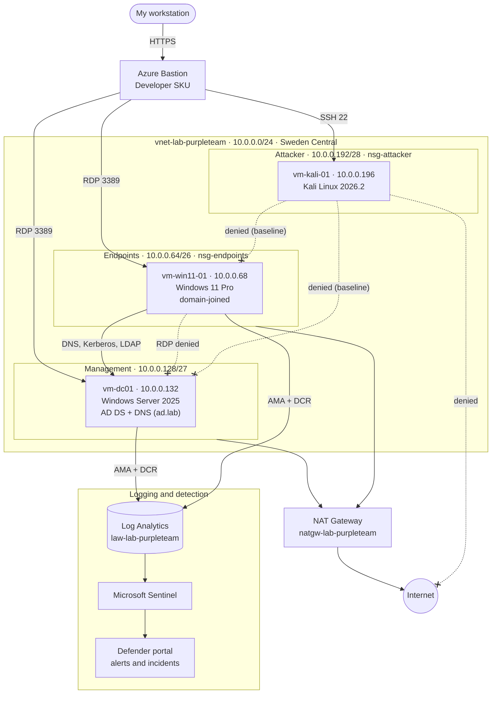
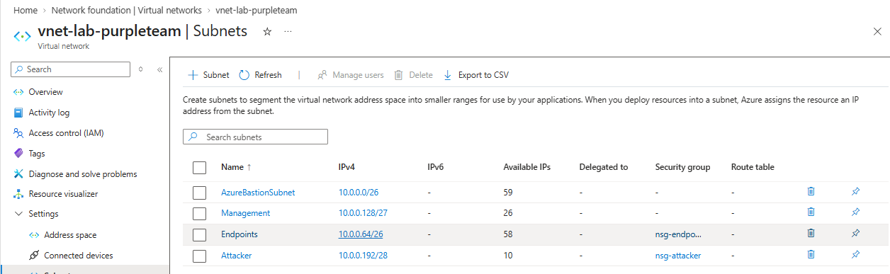
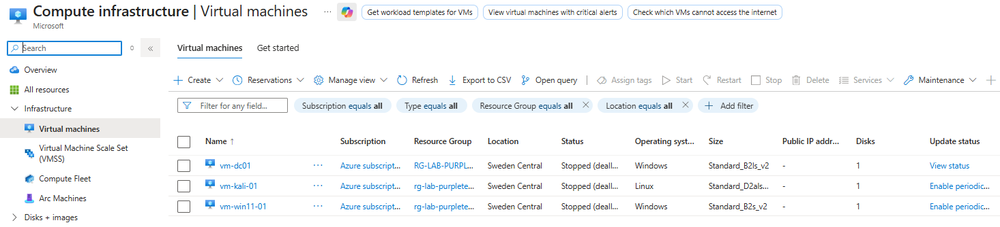
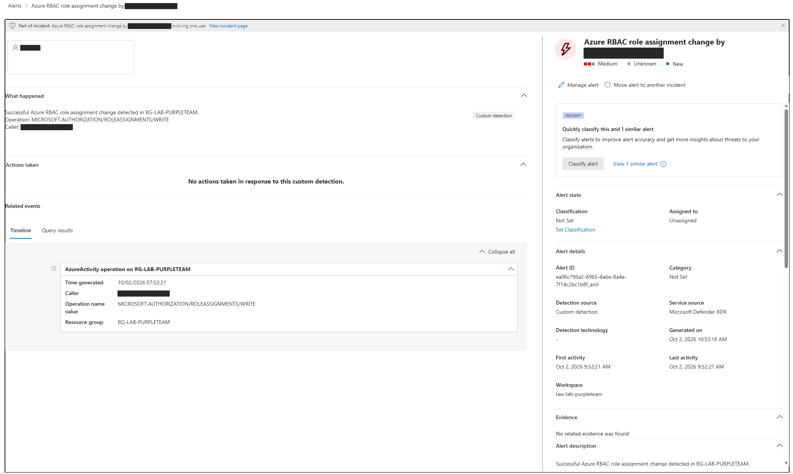

# Azure Purple Team Lab

A small purple team lab that I built in my own Azure subscription. I use it to practise network segmentation, Active Directory, central logging and detection engineering with Microsoft Sentinel and Microsoft Defender XDR.

I don't want to just get things working. I want to be able to explain, for every part of the lab:

- how the traffic flows and where the security boundaries are
- which identities and permissions are used
- which logs are created and how they reach the SIEM
- how an activity is detected, and how I verified that the detection actually works

> **Scope:** This is a lab environment. Everything described here was built and tested in my own Azure subscription. A test only proves the specific flow, port or event that was tested, so the documentation says exactly what was verified and what wasn't.

---

## Architecture



| Component | Configuration | Purpose |
| --- | --- | --- |
| `vnet-lab-purpleteam` | 10.0.0.0/24, Sweden Central | Lab network split into zones |
| `vm-dc01` | Windows Server 2025, Management subnet, static IP 10.0.0.132 | Domain controller and DNS for `ad.lab` |
| `vm-win11-01` | Windows 11 Pro, Endpoints subnet, 10.0.0.68 | Domain-joined workstation |
| `vm-kali-01` | Kali Linux 2026.2, Attacker subnet, 10.0.0.196, SSH key auth | Attacker machine for controlled tests |
| Azure Bastion | Developer SKU (`AzureBastionSubnet` 10.0.0.0/26 exists in the VNet) | Admin access without public IPs on the VMs |
| `natgw-lab-purpleteam` | Associated with Management and Endpoints | Outbound internet without public IPs on the VMs |
| `nsg-endpoints` | Associated with the Endpoints subnet | Blocks RDP from clients to Management |
| `nsg-attacker` | Associated with the Attacker subnet | Default deny for the attacker zone |
| `law-lab-purpleteam` | Log Analytics workspace with Microsoft Sentinel | Central log storage, KQL, analytics rules |

No VM has a public IP. Auto-shutdown is enabled to keep the cost down.





---

## Design principles

**Baseline first, then restrict, then test again.** Each zone was first verified with open connectivity. Then I added NSG rules and ran the same tests again, so every rule has a before and after.

**A subnet is not a security boundary.** Azure routes traffic between subnets in the same VNet by default. Before `nsg-attacker` was associated, Kali could reach both the DC and the Windows client. The model I use:

```
Subnet  = structure
Routing = is there a path?
NSG     = is the traffic allowed to use it?
```

**Default deny, explicit allow per scenario.** The Attacker zone is closed by default. When a scenario needs a specific port (for example TCP/445 for SMB or TCP/5985 for WinRM), a specific allow rule is added above the broad deny rule and removed when the scenario is done.

**Separate admin traffic from outbound traffic.** Admin access goes through Bastion, outbound traffic goes through the NAT Gateway. Neither path requires a public IP on a VM.

---

## Verified traffic flows

| Source | Destination | Traffic | Result | Verified with |
| --- | --- | --- | --- | --- |
| Bastion | Kali | TCP/22 | Allowed | SSH session |
| Bastion | DC, Win11 | RDP | Allowed | RDP session |
| Win11 | DC | TCP/3389 | Denied | `Test-NetConnection` (True → False), IP flow verify |
| Win11 | DC | TCP/445 | Allowed | IP flow verify (control test) |
| Win11 | DC | DNS / AD | Allowed | `nslookup ad.lab`, domain join, domain logon |
| Kali | DC | ICMP, TCP/3389 | Denied | `ping`, `nc` (worked before NSG) |
| Kali | Win11 | TCP/3389 | Denied | `nc` (worked before NSG) |
| Kali | Internet | TCP/443 | Denied | `nc -zv 1.1.1.1 443` |
| DC | Kali | TCP/22 | Denied | `Test-NetConnection` |
| DC | Internet | TCP/443 | Allowed | `Test-NetConnection` (False → True after NAT Gateway) |

These results cover only the tested flows. They do not prove that every port and protocol in every direction is blocked.

Details: [docs/03-segmentation.md](docs/03-segmentation.md)

---

## Telemetry pipelines

The lab collects two kinds of telemetry, and they reach Sentinel in different ways:

```
Endpoint
Windows Event Log → Azure Monitor Agent → Data Collection Rule → Log Analytics → Sentinel

Azure control plane
Azure Activity Log → Diagnostic setting (deployed by Azure Policy) → Log Analytics (AzureActivity) → Sentinel
```

Collected Windows data includes Security events (audit success and failure) and `Microsoft-Windows-PowerShell/Operational` event ID 4104. Process creation events (4688) include the command line, enabled through Group Policy. PowerShell Script Block Logging is enabled through a separate GPO for domain controllers.

Each layer was verified separately: agent installed ≠ agent communicating (`Heartbeat`) ≠ the right events collected (`Event`) ≠ events that can be analysed (parsed fields in KQL).

Details: [docs/04-logging-pipeline.md](docs/04-logging-pipeline.md)

---

## Detections

| Rule | Data source | Platform | MITRE ATT&CK | Status |
| --- | --- | --- | --- | --- |
| Lab v2 - labadmin starts PowerShell on DC | Event 4688 (`Event` table) | Defender XDR custom detection | T1059.001 PowerShell | Alert and incident verified, scheduled runs verified |
| LAB - PowerShell 4104 Detection Test | Event 4104 | Sentinel scheduled analytics rule | T1059.001 PowerShell | Alert and incident verified, tuned |
| LAB - Azure RBAC Role Assignment Change | `AzureActivity` | Defender XDR custom detection | – | Alerts for role assignment write and delete, grouped in one incident |

Each detection was tested with a controlled activity that has a unique test marker, so that the event can be traced through every step:

```
Activity → event created locally → event in Log Analytics → rule query matches → alert → incident
```



Details: [docs/05-detections.md](docs/05-detections.md) · KQL: [detections/](detections/)

---

## Troubleshooting highlights

Some of the most useful learning came from things that didn't work:

- **Custom detection ran with status "Completed" but never created an alert.** The cause was very likely that a different Sentinel workspace was set as primary in the Defender portal. Custom detections were limited to the primary workspace at the time.
- **Entity mapping referred to columns that the rule query no longer returned.** I fixed it by recreating `HostName` and `DnsDomain` from `Computer`.
- **Event 4104 stopped appearing.** Script Block Logging was not active according to `gpresult` and the registry. The fix was a dedicated GPO.
- **Duplicate alerts from one test.** The rule ran every 5 minutes with a 10-minute lookback, so the query windows overlapped.
- **Recurring Bastion "Connection Error".** The cause was the Bastion Developer SKU, which supports one session at a time, combined with a session that was left hanging.
- **The Bastion allow rule on Kali didn't work.** The traffic came from `168.63.129.16`, not from the subnet range I had assumed.
- **`AllocationFailed` when starting a VM.** Azure lacked capacity for that VM size in the region. Resizing to another SKU solved it.

Details: [docs/06-troubleshooting.md](docs/06-troubleshooting.md)

---

## Key lessons

- Verify every layer separately. An event in the Activity Log is not the same as an event in Sentinel, and data in Sentinel doesn't mean that the rule matches it.
- "Completed" means that a rule ran, not that it found anything.
- Check workspace, data source and scope before changing queries or log configuration.
- Use positive control tests. A failed test only means something if you know that the test traffic was allowed to reach the target.
- Keep observation, hypothesis, action and verified conclusion apart in the documentation.

---

## Next steps

- Move Windows Security event collection from the `Event` table to `SecurityEvent`
- Make the DCR more selective to balance detection value against cost
- Run controlled attack scenarios from Kali with scenario-specific NSG rules
- Extend telemetry with Entra ID sign-in and audit logs

Scenario design approach: [docs/07-scenario-design.md](docs/07-scenario-design.md)

---

## Documentation

| File | Content |
| --- | --- |
| [01-network-and-access.md](docs/01-network-and-access.md) | VNet, subnets, Bastion, NAT Gateway, first VMs |
| [02-active-directory.md](docs/02-active-directory.md) | Domain controller, DNS, domain join |
| [03-segmentation.md](docs/03-segmentation.md) | `nsg-endpoints`, `nsg-attacker`, before/after tests |
| [04-logging-pipeline.md](docs/04-logging-pipeline.md) | Log Analytics, AMA, DCR, audit policy, Azure Activity |
| [05-detections.md](docs/05-detections.md) | Detection rules, testing and tuning |
| [06-troubleshooting.md](docs/06-troubleshooting.md) | Problems, hypotheses and root causes |
| [07-scenario-design.md](docs/07-scenario-design.md) | How I choose purple team scenarios |
