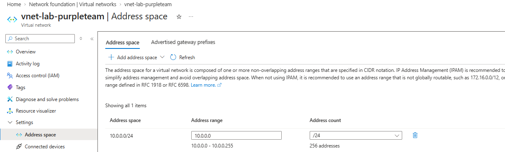

# 01 – Network and access

## Goal

Build the network foundation and verify placement, admin access and outbound traffic before adding Active Directory or NSG rules.

## Network design

| Subnet | Range | Contents | NSG |
| --- | --- | --- | --- |
| AzureBastionSubnet | 10.0.0.0/26 | Reserved for Bastion | – |
| Endpoints | 10.0.0.64/26 | `vm-win11-01` (10.0.0.68) | `nsg-endpoints` |
| Management | 10.0.0.128/27 | `vm-dc01` (10.0.0.132) | – |
| Attacker | 10.0.0.192/28 | `vm-kali-01` (10.0.0.196) | `nsg-attacker` |

VNet: `vnet-lab-purpleteam`, address space 10.0.0.0/24, resource group `rg-lab-purpleteam`, region Sweden Central.



Azure reserves the first addresses in every subnet, so the first usable address in Management (10.0.0.128/27) is 10.0.0.132. The gateway is the first address after the network address (10.0.0.129).

## Admin access and outbound traffic

```
Admin:     My workstation → Azure Bastion → RDP/SSH → VM
Outbound:  VM → NAT Gateway (natgw-lab-purpleteam) → Internet
```

- No VM has a public IP, so nothing is directly exposed to the internet.
- Bastion uses the **Developer SKU**. It costs nothing extra but supports only one session at a time (see [troubleshooting](06-troubleshooting.md)).
- The subnets are private and had no outbound path by default. A NAT Gateway with its own public IP (`pip-natgw-lab-purpleteam`) gives a controlled outbound path. It is associated with Management and Endpoints, but not with Attacker.

## First VM: vm-dc01

| Setting | Value |
| --- | --- |
| OS | Windows Server 2025 Datacenter |
| Size | `Standard_B2ls_v2` (2 vCPU / 4 GiB) |
| Subnet / IP | Management / 10.0.0.132 (later set to static) |
| Public IP | None |

**Baseline verification** with `ipconfig /all`:

- IPv4 10.0.0.132, mask 255.255.255.224 (/27)
- Default gateway 10.0.0.129
- DNS 168.63.129.16 (Azure-provided DNS)

Windows showed the same configuration as the Azure portal.

**Outbound test:**

```powershell
Test-NetConnection www.microsoft.com -Port 443
```

| Before NAT Gateway | After NAT Gateway |
| --- | --- |
| `TcpTestSucceeded : False` | `TcpTestSucceeded : True` |

The VM can start outbound connections without a public IP of its own.

## Windows endpoint: vm-win11-01

| Setting | Value |
| --- | --- |
| OS | Windows 11 Pro |
| Size | 2 vCPU / 4 GiB at first, later 8 GiB (`Standard_B2s_v2`) |
| Subnet / IP | Endpoints / 10.0.0.68 |
| Public IP | None |
| NIC NSG | None (filtering is done at subnet level) |
| Tags | `Environment=Lab`, `Project=PurpleTeam` |

The client was created **before** AD DS and DNS, so that basic connectivity between Endpoints and Management could be verified without dependencies on DNS, Kerberos or Active Directory.

Baseline test from the client, before any NSG rules:

```powershell
Test-NetConnection 10.0.0.132 -Port 3389
# TcpTestSucceeded : True
```

### Outbound for Endpoints

After the domain join, DNS worked but HTTPS did not:

```powershell
nslookup www.microsoft.com                       # resolved via 10.0.0.132
Test-NetConnection www.microsoft.com -Port 443   # TcpTestSucceeded : False
```

The cause was that the NAT Gateway was associated only with Management. After associating it with Endpoints as well, the client had an outbound path. A successful DNS lookup does not mean that the VM has internet access.

## Attacker VM: vm-kali-01

| Setting | Value |
| --- | --- |
| Image | Kali 2026.2, x64 Gen2 |
| Size | `Standard_D2als_v6` (2 vCPU / 4 GiB) |
| Subnet / IP | Attacker / 10.0.0.196 |
| Authentication | SSH public key |
| Public IP | None |
| Managed identity | Off |
| Auto-shutdown | 17:00 |

Creating the VM was first blocked by quotas. The Free Trial subscription did not allow quota increases, so I upgraded the subscription and raised the regional vCPU quota. The Bsv2 family had a separate quota, so instead of waiting for a support case I chose a size from another family. The private SSH key is stored locally with file permissions restricted to my own user (`icacls`).

Verified through Bastion: SSH login works, `ip addr` shows 10.0.0.196/28 on `eth0` and `ip route` shows default gateway 10.0.0.193.

**Important observation:** Kali had a route out of its own subnet. A separate subnet does not isolate anything by itself. See [03-segmentation.md](03-segmentation.md).
