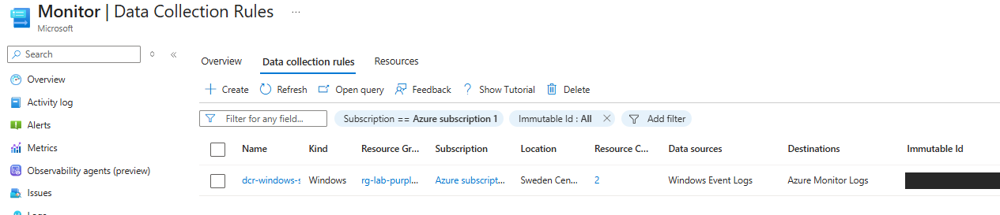
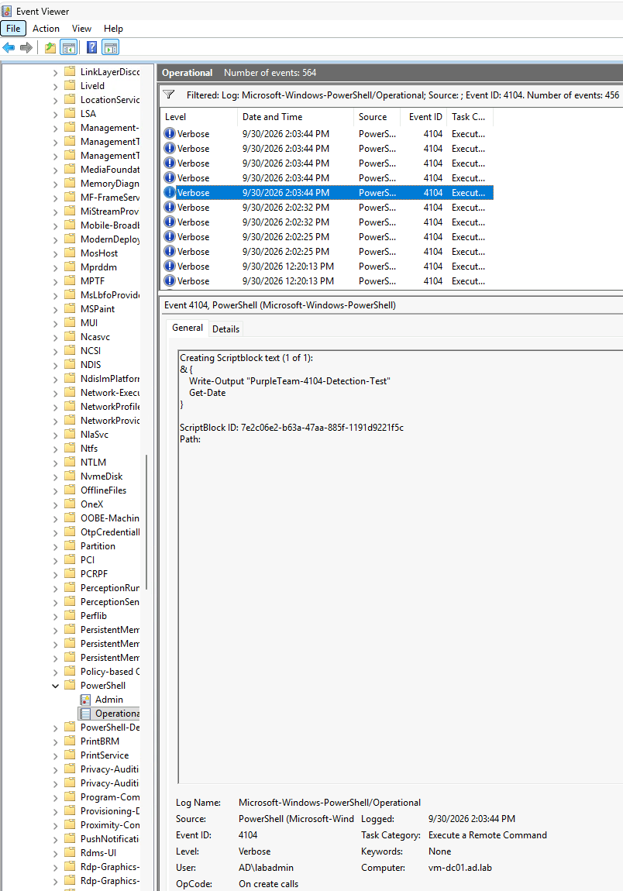
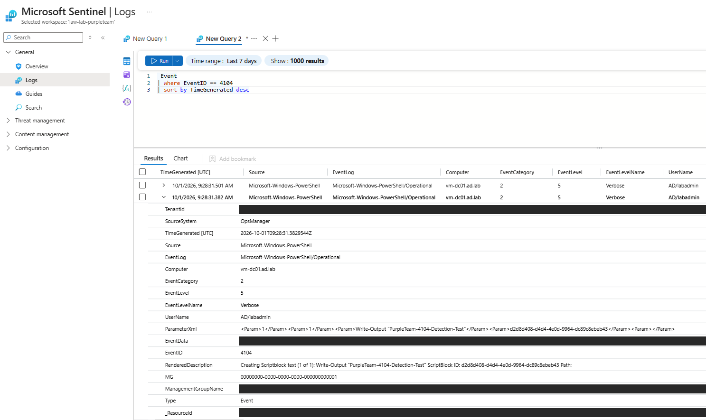

# 04 – Logging pipeline

## Mental model

```
Logging    = the event is created (on the machine or in Azure)
Collection = the event is collected and stored centrally
Detection  = a rule looks for a behaviour in the data
Response   = an alert or incident is created
```

Each layer was verified separately. A step that works doesn't prove that the next one does.

---

## Log Analytics and Sentinel

| Resource | Value |
| --- | --- |
| Workspace | `law-lab-purpleteam` |
| Resource group | `rg-lab-purpleteam` |
| Region | Sweden Central |
| Pricing tier | Pay-as-you-go |
| SIEM | Microsoft Sentinel enabled on the workspace |

Design decision: don't collect all available data by default. Collection should be selective to balance detection value against cost.

---

## Endpoint telemetry

```
Windows Event Log → Azure Monitor Agent (AMA) → Data Collection Rule (DCR) → Log Analytics → Sentinel
```

### Data Collection Rule

| Setting | Value |
| --- | --- |
| Name | `dcr-windows-security-lab` |
| Type | Agent-based, Windows |
| Data source | Windows Event Logs |
| Collected | Security log (Audit Success, Audit Failure), `Microsoft-Windows-PowerShell/Operational` event ID 4104 |
| Destination | `law-lab-purpleteam` |
| Associated VMs | `vm-win11-01`, later also `vm-dc01` |



This path writes to the generic **`Event`** table. The goal of the first step was to get the whole chain working, not to build the final Sentinel configuration. A planned improvement is to move Security events to the `SecurityEvent` table.

When the DCR was associated, AMA was installed on the VM (`AzureMonitorWindowsAgent`, status *Provisioning succeeded*).

### Verifying the chain, layer by layer

| Layer | How it was verified |
| --- | --- |
| Agent installed | VM → Extensions + applications |
| Agent communicating | `Heartbeat` table, category *Azure Monitor Agent* |
| Events collected | `Event` table, source `Microsoft-Windows-Security-Auditing` |
| Events can be analysed | KQL that extracts account, logon type and process name |

Agent installed ≠ agent communicating ≠ the right events collected ≠ events that can be analysed.

### Controlled logon test

I logged out of `vm-win11-01`, connected again through Bastion as `labadmin` and searched for event 4624. The parsed result showed:

```
AccountDomain: AD
AccountName:   labadmin
LogonType:     10   (RemoteInteractive, as expected for an RDP session via Bastion)
EventID:       4624
```

Note: a 4624 event contains several identities (Subject and New Logon). The first account name in the event is not always the one that logged on. The computer account `VM-WIN11-01$` shows up too.

Query: [detections/logon-4624-parsed.kql](../detections/logon-4624-parsed.kql)

### Security events seen on the DC

| Event ID | Meaning |
| --- | --- |
| 4624 | Successful logon |
| 4634 | Logoff |
| 4672 | Special privileges assigned to new logon |
| 4673 | A privileged service was called |
| 4627 | Group membership information |
| 4688 | A new process has been created |

### Process creation with command line (4688)

At first 4688 events showed the process name and account but no real command line. I enabled it through GPO:

```
Computer Configuration → Policies → Administrative Templates → System → Audit Process Creation
→ Include command line in process creation events = Enabled
```

After `gpupdate /force`, 4688 events contained process name, account and command line.

4688 shows that a **process was started**, for example `powershell.exe`. It doesn't show the commands typed inside an already open PowerShell session. That requires Script Block Logging.

### PowerShell Script Block Logging (4104)

Script Block Logging was enabled through a **separate GPO for Domain Controllers**. Event 4104 records the content of the PowerShell code that runs.

Test marker on `vm-dc01`:

```powershell
Write-Output "PurpleTeam-4104-Detection-Test"
```

Verified locally in Event Viewer:



Verified centrally in Log Analytics:



One test can create several 4104 events, because PowerShell splits longer code into blocks and logs each block separately.

---

## Azure control plane telemetry

An attacker with a stolen Azure account can do serious damage without ever logging in to a VM, for example by granting a role, deleting resources or opening a firewall. That activity is only visible in the control plane logs.

```
Azure Activity Log → Diagnostic setting → Log Analytics (AzureActivity) → Sentinel
```

This path uses no agent and no DCR.

### Setup

1. Installed the **Azure Activity** solution from Sentinel Content hub. The connector showed *Disconnected*.
2. Assigned the Azure Policy *Configure Azure Activity logs to stream to specified Log Analytics workspace* at subscription level, with `law-lab-purpleteam` as destination.
3. The policy uses `DeployIfNotExists`. The subscription was first non-compliant. A remediation task with a system-assigned managed identity ran through *Evaluating → In Progress → Complete*.
4. The remediation created the diagnostic setting `subscriptionToLa`.

Azure Policy remediation is asynchronous. The configuration is not in place the moment the assignment is saved.

### Verification

```kusto
AzureActivity
| top 20 by TimeGenerated desc
```

The first events included traces of the setup itself (`POLICIES/DEPLOYIFNOTEXISTS/ACTION`, `DEPLOYMENTS/WRITE`, `DIAGNOSTICSETTINGS/WRITE`). Azure logs its own configuration changes.

---

## Three telemetry layers

| Layer | What it logs | Sources | Status in the lab |
| --- | --- | --- | --- |
| Endpoint | What happens on a machine | Windows events, PowerShell 4104 | Collected |
| Azure control plane | Who creates, changes or deletes resources and assigns permissions | Azure Activity Log | Collected |
| Identity | Who signs in and what changes are made to accounts | Entra ID sign-in and audit logs | Not yet collected |
