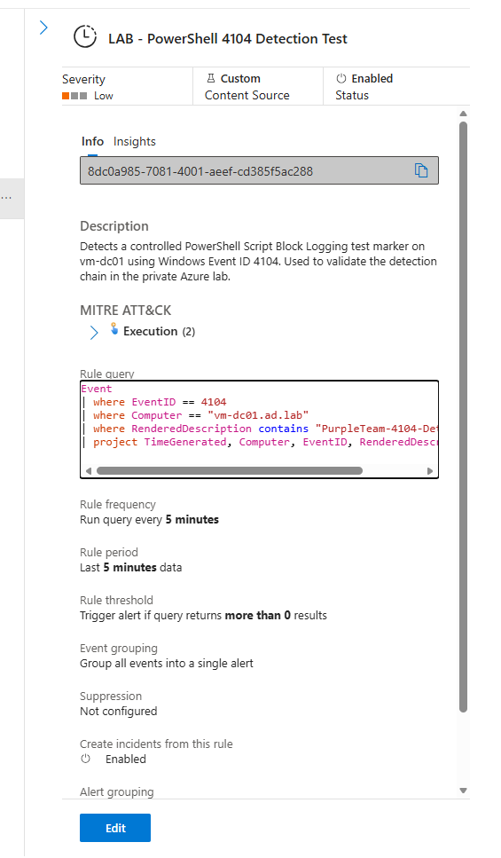
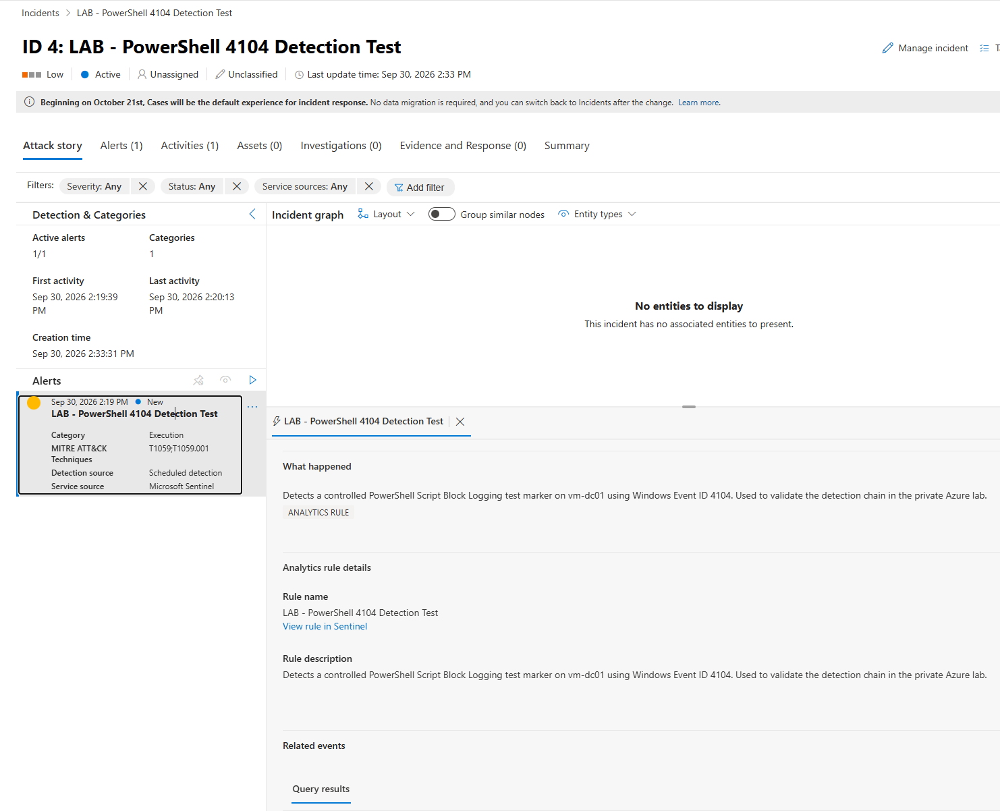
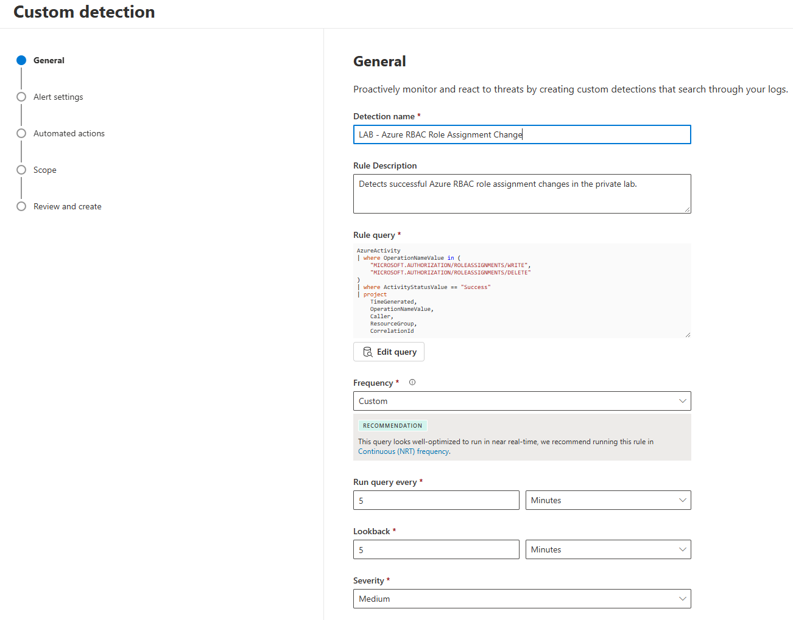
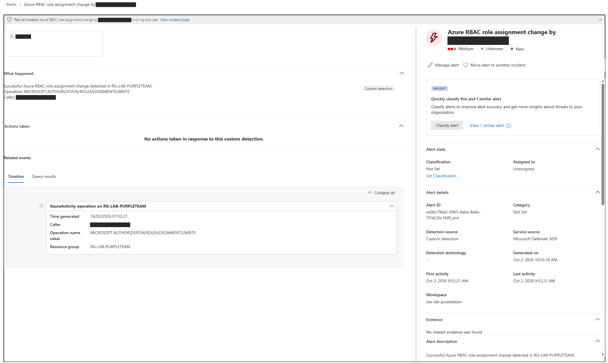
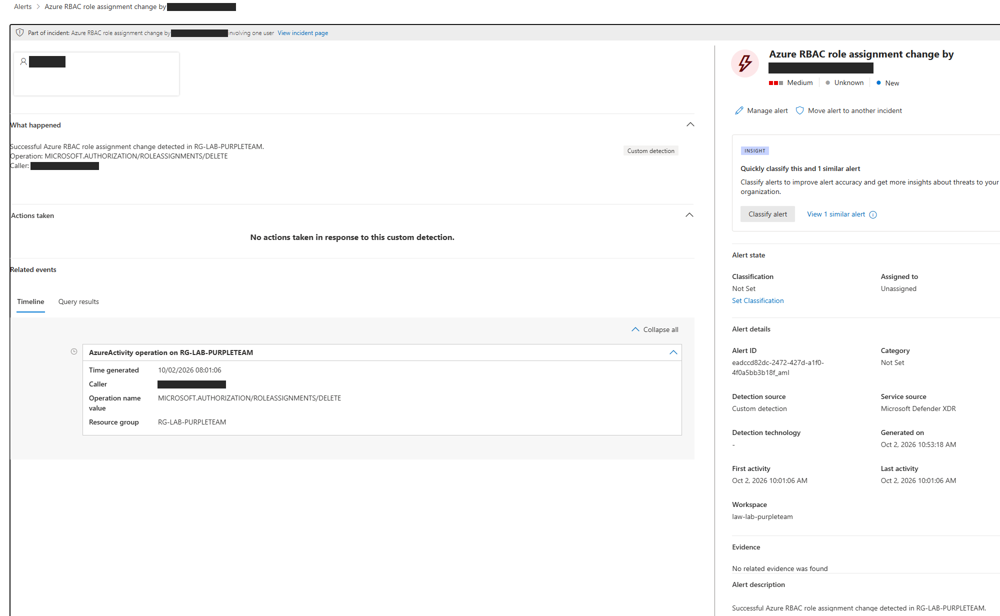
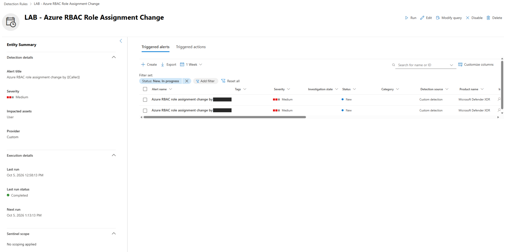

# 05 – Detections

Every detection was tested with a controlled activity that contains a unique test marker. That makes it possible to follow one specific event through the whole chain:

```
Activity → event created locally → event in Log Analytics → rule query matches → alert → incident
```

Sentinel and Defender are used side by side through the Defender portal:

| Component | Role |
| --- | --- |
| Log Analytics | Where the logs are stored |
| Microsoft Sentinel | SIEM on top of the log data: KQL, hunting, analytics rules |
| Microsoft Defender XDR | Correlates signals and presents alerts and incidents in the Defender portal |
| Custom detection | A rule in the Defender portal that runs detection logic on a schedule |

---

## 1. PowerShell started on the DC (event 4688)

| Setting | Value |
| --- | --- |
| Name | `Lab v2 - labadmin starts PowerShell on DC` |
| Type | Defender XDR custom detection |
| Data | `Event` table, event ID 4688 |
| Severity | Low |
| MITRE ATT&CK | Execution, T1059.001 PowerShell |
| Frequency / lookback | Every hour / 4 hours |
| Entity mapping | Device → `HostName` + `DnsDomain` |
| Automated remediation | None |

The query parses account and process name from `RenderedDescription`. For entity mapping, `Computer` (`vm-dc01.ad.lab`) is split into `HostName` (`vm-dc01`) and `DnsDomain` (`ad.lab`).

Query: [detections/powershell-4688-dc.kql](../detections/powershell-4688-dc.kql)

**Result:** The rule created the alert *PowerShell started by labadmin on DC (v2)* with `vm-dc01` as device entity. A later scheduled run added a new test event to the existing alert, so scheduled runs are verified as well.

Getting there took some troubleshooting (see [06-troubleshooting.md](06-troubleshooting.md)): wrong primary workspace, and entity mapping that pointed to columns the query no longer returned.

**Open observations:**

- Advanced hunting showed 16 matching events, but the alert contained 3–4. Likely cause: new events from the same rule and entity are added to an existing alert. Not fully investigated.
- Without Defender for Endpoint the alerts lack process tree and timeline.

---

## 2. PowerShell Script Block Logging (event 4104)

| Setting | Value |
| --- | --- |
| Name | `LAB - PowerShell 4104 Detection Test` |
| Type | Sentinel scheduled analytics rule |
| Data | `Event` table, event ID 4104 on `vm-dc01.ad.lab` |
| Match | `RenderedDescription` contains the test marker |
| Severity | Low |
| MITRE ATT&CK | Execution, T1059 / T1059.001 PowerShell |
| Threshold | More than 0 results |
| Event grouping | All events in one alert |
| Incident creation | Enabled |

Query: [detections/powershell-4104-test-marker.kql](../detections/powershell-4104-test-marker.kql)



**Result:** The rule created an alert, and an incident was created in the Defender portal.



The incident has no entities, because no entity mapping is configured for this rule.

### Detection tuning

The first version ran **every 5 minutes with a 10-minute lookback**. The query windows overlapped, so the same event could match two runs:

```
10:05 run → searches 09:55–10:05
10:10 run → searches 10:00–10:10
An event at 10:02 matches both.
```

Together with several 4104 events per test, and one incident per alert, this gave many alerts for a single test.

I changed **one variable**: the lookback, from 10 to 5 minutes. After a new test the rule created **one** alert. That supports the conclusion that the overlap caused the duplicates.

Overlap is not always wrong. Logs can arrive with a few minutes of delay, and a window exactly as long as the interval may miss late events. Tuning is about weighing noise against the risk of missing something. The tools:

| Setting | Controls |
| --- | --- |
| Frequency | How often the rule runs |
| Lookback | How far back each run searches |
| Event grouping | How results from one run become alerts |
| Suppression | Whether new alerts are paused for a while after one fires |
| Alert grouping | How alerts are combined into incidents |
| Specific KQL | Narrower query, usually the most important tool |

5 min / 5 min is not verified as a good production setting. It gives less margin for ingestion delay.

One retest created no alert, because the event contained a different test marker than the one the rule looks for. The event content has to match the rule logic.

---

## 3. Azure RBAC role assignment change

| Setting | Value |
| --- | --- |
| Name | `LAB - Azure RBAC Role Assignment Change` |
| Type | Defender XDR custom detection |
| Data | `AzureActivity` |
| Match | `roleAssignments/write` or `roleAssignments/delete` with status Success |
| Frequency / lookback | 5 minutes / 5 minutes |
| Severity | Medium |
| Alert title | `Azure RBAC role assignment change by {{Caller}}` |
| Impacted asset | User |

Query: [detections/rbac-role-assignment-change.kql](../detections/rbac-role-assignment-change.kql)



### Test

I gave my own account a temporary **Reader** role on `rg-lab-purpleteam` and then removed it. (The account already had Owner through inheritance from the subscription. The assignment was made only to create a controlled RBAC event.)

| Operation | Azure Activity Log | `AzureActivity` | Alert |
| --- | --- | --- | --- |
| `MICROSOFT.AUTHORIZATION/ROLEASSIGNMENTS/WRITE` | ✓ | ✓ | ✓ |
| `MICROSOFT.AUTHORIZATION/ROLEASSIGNMENTS/DELETE` | ✓ | ✓ | ✓ |

Both alerts were grouped into the same incident.







An earlier delete event never showed up in `AzureActivity`. The root cause is not verified. The hypothesis is that the export was not yet stable at that point.

### Tuning ideas

A rule that fires on every role assignment works in a lab but would be noisy in a larger environment. A tuned version could take into account:

- **Which role:** Owner, Contributor and User Access Administrator are more sensitive than Reader
- **Which scope:** subscription vs resource group vs single resource
- **Who made the change:** known admin, service principal or unusual identity
- **Is the change expected:** approved change, automation, known admin activity
